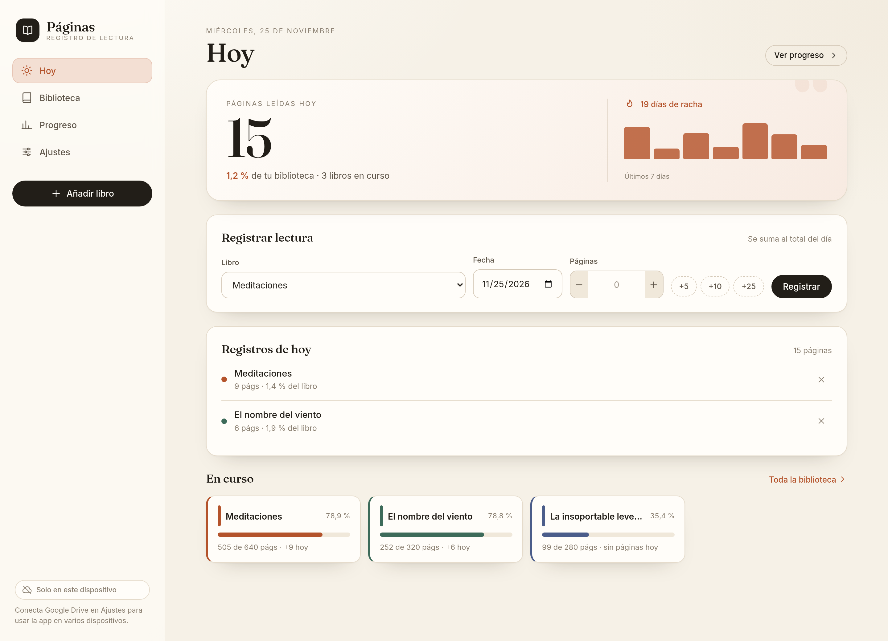

# Páginas

Registro de lectura personal: añade tus libros, anota las páginas que lees cada día y consulta tu
progreso. Funciona como app instalable (PWA), sin conexión, y sincroniza los datos con tu propio
Google Drive para tenerlos en todos tus dispositivos.

<p align="center">
  
</p>

**App en vivo:** <https://jaimemartinezr.github.io/reading-tracker/>


## Qué hace

- **Biblioteca:** alta de libros con título, autor opcional, total de páginas y color.
- **Registro diario:** anota cuántas páginas leíste de cada libro, con fecha (hoy o días pasados).
  Los registros del mismo día y libro se suman; puedes eliminar cualquier registro.
- **Cálculos automáticos:**
  - páginas leídas hoy y en los últimos 7/30 días;
  - porcentaje leído de cada libro (acumulado) y porcentaje del libro leído cada día;
  - porcentaje de tu biblioteca avanzado por día;
  - páginas restantes, ritmo medio y fecha estimada de fin;
  - racha de días seguidos leyendo, mejor día y media diaria.
- **Google Drive:** un archivo `lecturas.json` en una carpeta visible llamada **Proyecto Lectura**.
  La app funciona primero en local y sincroniza sola cuando hay conexión.
- **Multidispositivo real:** los cambios se combinan registro a registro (no se sobrescribe el
  archivo entero), con marcas de borrado, así que anotar desde el móvil y el portátil no pierde
  nada.
- **Extras:** exportar/importar JSON, modo oscuro, instalable en móvil y escritorio.

## Cómo usarla

1. Abre la app y pulsa **Añadir libro** (título y número de páginas).
2. Cada día, en **Hoy**, elige el libro, escribe las páginas y pulsa **Registrar**.
3. Consulta **Progreso** para ver el avance diario y por libro.
4. Para sincronizar entre dispositivos, configura Google Drive (siguiente apartado) en cada
   dispositivo con el mismo Client ID.

### Instalar como app

- **Android/Chrome:** menú ⋮ → *Añadir a pantalla de inicio*.
- **iPhone/Safari:** compartir → *Añadir a pantalla de inicio*.
- **Escritorio/Chrome o Edge:** icono de instalar en la barra de direcciones.

## Configurar Google Drive (una vez, ~5 minutos)

La app no tiene servidor: se conecta directamente a Drive desde el navegador con OAuth. Necesitas
crear tu propio **Client ID** en Google Cloud. Es gratis y solo lo usas tú.

1. Entra en [console.cloud.google.com](https://console.cloud.google.com/) y crea un proyecto
   (por ejemplo, «Páginas»).
2. **APIs y servicios → Biblioteca** → busca **Google Drive API** → **Habilitar**.
3. **APIs y servicios → Pantalla de consentimiento de OAuth**:
   - tipo de usuario **Externo**;
   - pon un nombre de app y tu correo de contacto;
   - en *Usuarios de prueba*, añade tu propia cuenta de Google.
4. **Credenciales → Crear credenciales → ID de cliente de OAuth**:
   - tipo de aplicación: **Aplicación web**;
   - **Orígenes de JavaScript autorizados**, añade exactamente los que uses:
     - `http://localhost:5173` (desarrollo local)
     - `https://TU_USUARIO.github.io` (si publicas en GitHub Pages)
5. Copia el **Client ID** (termina en `.apps.googleusercontent.com`).
6. En la app: **Ajustes → Google Drive**, pega el Client ID, pulsa **Guardar** y después
   **Conectar Drive**. Autoriza el acceso en la ventana de Google.

> La app solo pide el permiso `drive.file`: puede ver y modificar **únicamente los archivos que
> ella crea**. No puede leer el resto de tu Drive. Si borras la carpeta «Proyecto Lectura» desde
> Drive, la app la recrea en la siguiente sincronización.
>
> Mientras la pantalla de consentimiento esté en modo **Prueba**, Google caduca el acceso cada
> 7 días y tendrás que volver a pulsar «Reconectar Drive». Para evitarlo, publica la app en
> *Pantalla de consentimiento → Publicar app* (seguirá siendo solo para ti).

## Desarrollo local

Requisitos: Node.js 20.19+ y npm.

```bash
npm install
npm run dev        # http://localhost:5173
npm test           # tests de cálculos, merge y sincronización
npm run typecheck
npm run build      # genera dist/
npm run preview    # sirve la build
```

Variables opcionales (`.env.local`):

```bash
VITE_GOOGLE_CLIENT_ID=tu-client-id.apps.googleusercontent.com
VITE_BASE_PATH=/
```

Si defines `VITE_GOOGLE_CLIENT_ID`, la app arranca con ese Client ID ya rellenado (el usuario puede
cambiarlo en Ajustes). Si no, cada persona pega el suyo.

## Publicar en GitHub Pages

El repositorio incluye `.github/workflows/deploy.yml`, que en cada push a `main` ejecuta los tests,
compila con la ruta base del repositorio y publica en Pages.

1. En GitHub: **Settings → Pages → Build and deployment → Source: GitHub Actions**.
2. Haz push a `main` y espera al workflow *Deploy to GitHub Pages*.
3. La app quedará en `https://TU_USUARIO.github.io/reading-tracker/`.
4. Añade `https://TU_USUARIO.github.io` a los orígenes autorizados del Client ID.

La build usa `VITE_BASE_PATH=/NOMBRE_DEL_REPO/`; si renombras el repositorio, actualiza esa
variable en el workflow.

> GitHub Pages no está disponible para repositorios privados en el plan gratuito. Por eso este
> repositorio es público: no contiene secretos y tus datos de lectura siguen viviendo únicamente en
> tu Google Drive. Si prefieres mantener el código privado, necesitarás un plan de pago o publicar
> la carpeta `dist/` en otro hosting.

El Client ID de la build se inyecta con la **variable de repositorio** `VITE_GOOGLE_CLIENT_ID`
(*Settings → Secrets and variables → Actions → Variables*). Si haces un fork, define la tuya.

## Arquitectura y decisiones

```
src/
├─ domain/lib
│  ├─ stats.ts       cálculos de progreso y porcentajes
│  ├─ merge.ts       unión de datos por registro (last-write-wins + tombstones)
│  ├─ validate.ts    validación de datos de Drive o de un JSON importado
│  ├─ date.ts        fechas locales en formato YYYY-MM-DD
│  └─ storage.ts     persistencia en localStorage
├─ lib/drive
│  ├─ auth.ts        Google Identity Services (token OAuth en el navegador)
│  ├─ api.ts         REST de Drive v3 (carpeta + archivo JSON)
│  ├─ sync.ts        descargar → unir → subir con If-Match y reintentos
│  └─ errors.ts
├─ state/store.tsx   estado global, acciones y sincronización automática
├─ components/       UI reutilizable
└─ screens/          Hoy, Biblioteca, Progreso, Ajustes
```

**Modelo de datos**

```json
{
  "schemaVersion": 1,
  "books": [
    {
      "id": "uuid",
      "title": "Meditaciones",
      "author": "Marco Aurelio",
      "totalPages": 200,
      "color": "#b4532b",
      "createdAt": "2026-01-01T10:00:00.000Z",
      "updatedAt": "2026-01-01T10:00:00.000Z"
    }
  ],
  "entries": [
    {
      "id": "uuid",
      "bookId": "uuid",
      "date": "2026-01-02",
      "pages": 12,
      "createdAt": "2026-01-02T22:10:00.000Z",
      "updatedAt": "2026-01-02T22:10:00.000Z"
    }
  ],
  "updatedAt": "2026-01-02T22:10:00.000Z"
}
```

Para borrar se marca `deletedAt` en lugar de eliminar la fila. Al sincronizar, cada registro se une
por `id` y gana el `updatedAt` más reciente. Esa operación es **idempotente y conmutativa**, de modo
que da igual el orden o el número de sincronizaciones: ningún dispositivo pierde datos. Las
subidas usan `If-Match` con el ETag del archivo; si otro dispositivo escribió mientras tanto, se
re-descarga, se vuelve a unir y se reintenta (hasta 3 veces).

**Privacidad:** todo se guarda primero en `localStorage`. Solo se envía a Drive lo necesario para
sincronizar, dentro de tu cuenta. No hay analítica, servidores ni terceros.

## Problemas frecuentes

| Síntoma | Causa y solución |
| --- | --- |
| «El navegador bloqueó la ventana de Google» | Permite ventanas emergentes para el sitio y vuelve a pulsar Conectar. |
| «Client ID no válido» | Revisa que copiaste el ID completo y que el origen actual (`window.location.origin`) está en *Orígenes de JavaScript autorizados*. |
| `redirect_uri_mismatch` / `origin_mismatch` | Falta el origen exacto (incluye `https://` y sin barra final) en la credencial OAuth. |
| Pide reconectar cada 7 días | La pantalla de consentimiento está en modo Prueba: publícala o renueva el acceso. |
| «El archivo de Drive no es un JSON válido» | Alguien editó `lecturas.json` a mano. Descarga una copia, corrige el JSON o restaura una exportación. |
| No aparece el cambio en el otro dispositivo | Abre la app en el otro dispositivo (sincroniza al abrir y al volver a la pestaña) o pulsa «Sincronizar ahora». |

## Tests

```bash
npm test
```

38 tests cubren cálculos de páginas/porcentajes/rachas, el merge multidispositivo (incluidos
borrados y conflictos) y el flujo completo de sincronización contra un Drive simulado.

## Licencia

MIT.
